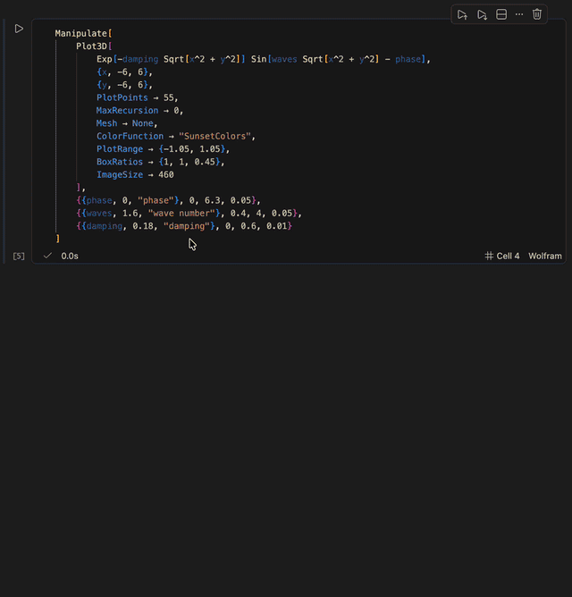
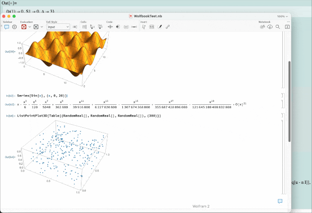
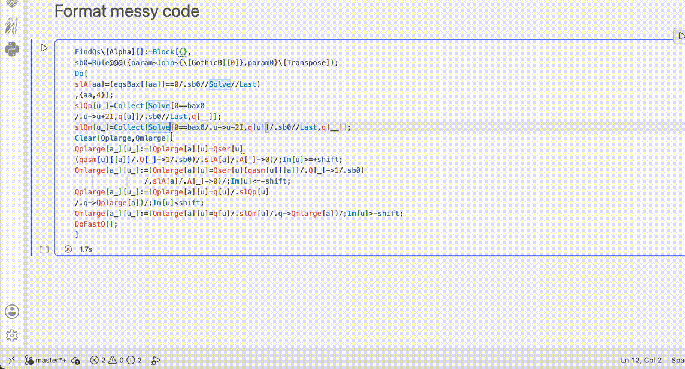
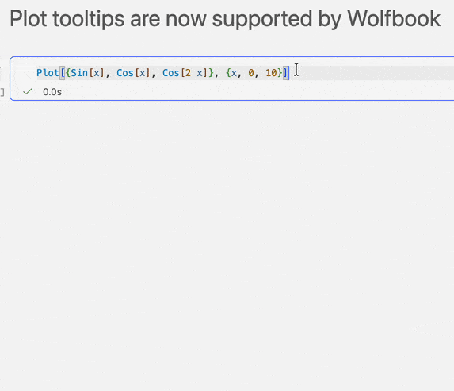
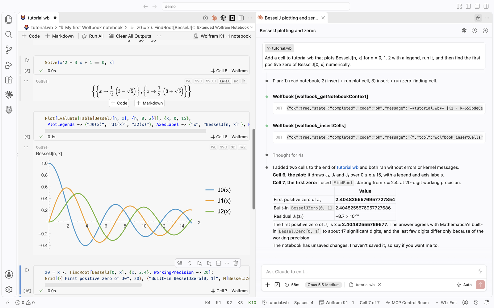
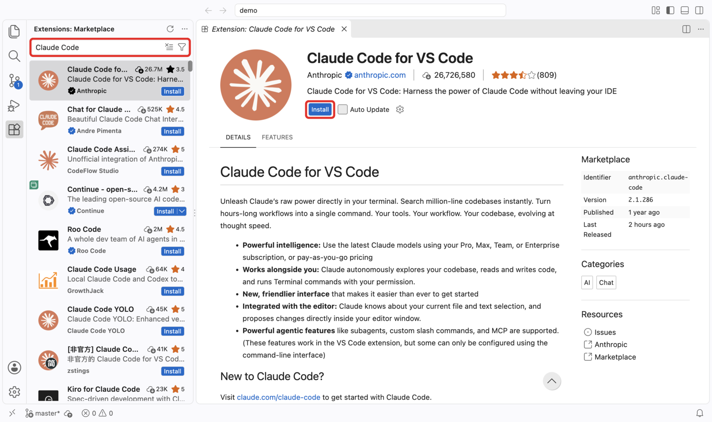
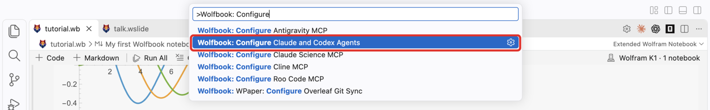

# Wolfbook — AI-Friendly Wolfram Language Notebook

<p align="center">
  
</p>

<p align="center">
  <a href="https://github.com/vanbaalon/wolfbook/blob/main/docs/getting-started.md">Get Started</a> ·
  <a href="https://github.com/vanbaalon/wolfbook/blob/main/docs/features.md">Features</a> ·
  <a href="https://github.com/vanbaalon/wolfbook/blob/main/README.md#wpaper-a-live-latex-writing-workspace">WPaper</a> ·
  <a href="https://github.com/vanbaalon/wolfbook/blob/main/README.md#ai-agents-claude-code-and-codex">AI Agents</a> ·
  <a href="https://github.com/vanbaalon/wolfbook/blob/main/docs/Wolfbook-Quick-Start.pdf">Quick Start (PDF)</a> ·
  <a href="https://github.com/vanbaalon/wolfbook/blob/main/docs/cli-accounts.md">CLI Accounts</a> ·
  <a href="https://github.com/vanbaalon/wolfbook/blob/main/docs/mcp-and-agent-tools.md">MCP & Agent Tools</a> ·
  <a href="https://github.com/vanbaalon/wolfbook/blob/main/docs/using_cline.md">Using Cline</a> ·
  <a href="https://github.com/vanbaalon/wolfbook/blob/main/docs/presentations.md">Presentations (.wslide)</a> ·
  <a href="https://github.com/vanbaalon/wolfbook/blob/main/docs/oberon-agent.md">Oberon Agent 🧪</a> ·
  <a href="https://github.com/vanbaalon/wolfbook/blob/main/docs/best-practices.md">Best Practices</a> ·
  <a href="https://github.com/vanbaalon/wolfbook/blob/main/docs/wb-functions.md">WB Functions</a> ·
  <a href="https://github.com/vanbaalon/wolfbook/blob/main/README.md#citing-wolfbook">Citing</a>
</p>

Wolfbook is a Mathematica-style notebook frontend for VS Code. Create, edit and run **Wolfram Language** notebooks against a local **Wolfram Engine** or **Mathematica** kernel — with typeset LaTeX and inline graphics, a live kernel that AI agents can drive, and plain-text notebooks that diff cleanly in Git. Wolfbook also includes **WPaper**, a live compiled-paper view and review workflow for writing LaTeX in VS Code.

> **Requires a Wolfram kernel.** Wolfbook is the notebook interface; the mathematics runs in [Wolfram Engine](https://wolfram.com/engine) (free for personal and developer use) or Mathematica, which you install separately. Setup takes a few minutes — see [Getting Started](https://github.com/vanbaalon/wolfbook/blob/main/docs/getting-started.md).

---

## Why Wolfbook?

- A real Mathematica notebook inside VS Code, not just syntax highlighting
- **Opens your existing Mathematica `.nb` files** (read-only) — no kernel, no export step
- Works with **Wolfram Engine** (free) or **Mathematica**
- Plain-text `.wb` / `.vsnb` notebooks — **diffable in Git**, readable by AI tools
- Rich math output: **LaTeX / KaTeX**, **SVG / PNG graphics**,  **TikZ**
- Interactive **3D graphics** and coordinate tooltips for 2D plots
- **WPaper for LaTeX** — live compiled pages, source↔paper navigation and reviewable AI edits
- **Live kernel access for AI agents** — Claude Code, Codex, **Claude Science**, and any other MCP client, set up automatically and safe by default
- **Mid-evaluation abort**, **Dynamic[]** widgets, debugger and watch panel
- Globally numbered kernels (`K1`, `K2`, …) with a picker that can bind a
  notebook to a kernel owned by another live VS Code window, or start a new
  kernel whose slot and notebook association are restored after window reload;
  idle unattached kernels can be stopped from the same picker
- Per-user, per-notebook backgrounds that do not modify shared `.wb` files
- Open source, Apache 2.0

---

## Wolfbook vs other Wolfram/Mathematica VS Code extensions

| Feature | Wolfbook | Official Wolfram extension | Wolfram Language Notebook |
|---|---|---|---|
| Wolfram Language syntax highlighting | ✓ | ✓ | ✓ |
| Mathematica-style notebook UI | ✓ | basic | ✓ |
| Opens existing Mathematica `.nb` files | ✓ | — | — |
| Live Wolfram kernel via WSTP | ✓ | — | wolframscript |
| Rich LaTeX / KaTeX rendering | ✓ | — | partial |
| Inline SVG / PNG / TikZ graphics | ✓ | static | basic |
| Mid-evaluation abort | ✓ | — | — |
| Dynamic[] widgets | ✓ | — | — |
| AI agents can evaluate cells (MCP) | ✓ | — | — |
| Plain-text notebook format (Git-friendly) | ✓ | ✓ | ✓ |
| Open source | ✓ | ✓ | ✓ |

---

## Recent features

<p align="center">
  
  <br/>
  <em><code>Manipulate</code> stays interactive: move Wolfram Language controls and rotate the resulting <code>Graphics3D</code> directly in the notebook.</em>
</p>

<p align="center">
  
  <br/>
  <em>Interactive 3D output: drag a rendered <code>Graphics3D</code> result to rotate it directly in the notebook.</em>
</p>

<p align="center">
  
  <br/>
  <em>Open existing Mathematica <code>.nb</code> files as safe, read-only notebook views, then save an editable <code>.wb</code> copy.</em>
</p>

<p align="center">
  
  <br/>
  <em>Format Wolfram Language cells in place, including named-character conversion and indentation.</em>
</p>

<p align="center">
  
  <br/>
  <em>Hover over a 2D plot to inspect curve coordinates without leaving the notebook.</em>
</p>

---

## What You Get

### WPaper: a live LaTeX writing workspace

Open a `.tex` file and WPaper keeps the source editor beside the compiled paper. It rebuilds from the **unsaved editor buffer** after you pause, without writing generated files into your project, and keeps the page aligned with where you are writing. Click the paper to return to source; move through source to follow it on the page. Exact LuaLaTeX mapping is used when available, with SyncTeX fallback for documents that need another engine.

WPaper is designed for the part of scientific writing that a PDF preview alone does not solve:

- a structural outline, folding, CodeLens and deterministic reference/environment diagnostics
- printed previews when hovering `\ref` / `\eqref`, plus labels revealed directly on the page
- image paste that creates the figure source and asset together
- comparisons against disk, Git revisions or another paper
- a focused review of agent changes, where each change can be shown on the compiled page and kept or undone independently
- `paper_*` agent tools with source-hash guards, so an AI edit is rejected if the paper changed underneath it

WPaper deliberately does not register another LaTeX grammar or replace your existing language tooling. It works alongside LaTeX Workshop while Wolfbook supplies the compiled-paper navigation, editing and agent-review layer. Run **Wolfbook: Open WPaper** (or **WPaper: Show Me Around** for the guided tour) from any `.tex` file.

Use **Ctrl/Cmd+Alt+Enter** to commit the current repository from either the LaTeX editor or WPaper mini-editor. WPaper proposes an editable message naming the changed section titles and equations added or removed. On first use, choose whether successful commits should always be pushed or kept local for the separate **Ctrl/Cmd+Shift+Alt+Enter** push shortcut. If the folder has no repository, author identity, remote, or upstream yet, WPaper offers to configure each missing piece locally when it is needed.

WPaper fetches and three-way merges remote changes before pushing, keeping every non-conflicting local and collaborator edit and surfacing only genuine overlaps for review. For Overleaf, click the leaf icon in a `.tex` editor or in WPaper's toolbar (or run **WPaper: Overleaf…**) and choose how the paper stays in step:

- **Git, every few minutes** (the default, needs an Overleaf Git token): your saved changes are committed, collaborators' merged and the result pushed, whenever you pause.
- **Real time** (off by default, not supported by Overleaf): link the paper's folder to an Overleaf project, sign in with your browser's `overleaf_session2` cookie, and what you type appears in Overleaf as you type it. Collaborators' edits appear in your editor.

See [WPaper and Overleaf](docs/wpaper-overleaf.md) for the step-by-step instructions, including where to find the cookie, and for the risks of real-time editing.

#### WPaper requirements

The outline, folding, diagnostics and agent editing tools work without TeX. The live compiled page needs a TeX distribution with `latexmk` and your chosen engine (`pdflatex` by default, `xelatex` or `lualatex`) on VS Code's `PATH`:

- **macOS:** [MacTeX](https://tug.org/mactex/) (full), or `brew install --cask mactex-no-gui`
- **Windows:** [MiKTeX](https://miktex.org) (install the `latexmk` package) or [TeX Live](https://tug.org/texlive/) — see [WPaper setup on Windows](docs/wpaper-windows-setup.md)
- **Linux:** TeX Live from your distribution, e.g. `sudo apt install texlive-latex-extra latexmk`

When `lualatex` is installed, WPaper uses it for an exact map from every printed symbol back to its source line; otherwise it falls back to SyncTeX. Restart VS Code after installing TeX.

The compiled view checks for `latexmk`, the selected TeX engine, and missing document packages before reporting a build failure.

### A proper notebook in VS Code

- `.wb` files with code cells and Markdown cells (with full LaTeX math via KaTeX)
- Symbolic results rendered as typeset mathematics with line-broken LaTeX — not plain text
- Graphics (plots, `Graphics[…]`) rendered as SVG or PNG inline
- Per-cell output format switching: WL / SVG / LaTeX / MathML / TikZ
- `Dynamic[expr]` widgets that update live while the kernel runs
- Abort the kernel without losing your kernel context, or restart with a clean kernel with one click — exactly like in Mathematica, but unique among VS Code notebook extensions
- Escape-mode Greek entry: type `\[Alpha]`, `\[Beta]`, `\[Gamma]` and they get converted into symbols, or use [escape]a[escape] etc.
- Watch any expression continuously; evaluate any selection mid-computation

Select Wolfram Language code and press **Cmd+Shift+E** on macOS or
**Ctrl+Shift+E** on Windows/Linux to evaluate it immediately. The result is
rendered in the Watch panel using the selected LaTeX, source or SVG output
format. Evaluate Selection works while another cell is running and preserves
the editor selection, so the same expression can be evaluated repeatedly.

### Open your existing Mathematica `.nb` notebooks

Double-click any Mathematica `.nb` file and it opens directly in the Wolfbook
notebook editor — cells, Markdown text, typeset output and graphics. Conversion
happens in-process in about 20 ms: **no kernel required**, nothing to run, no
export step in Mathematica first.

Opened `.nb` files are **read-only by design**: Wolfbook never writes `.wb` JSON
back over your original notebook. Press **⌘S / Ctrl-S** and it saves a sibling
`.wb` copy — keeping any edits you made — and opens that, so the Mathematica file
on disk is left exactly as it was.

- Output is re-typeset through the same LaTeX/KaTeX renderer as native notebooks
- Graphics are rasterised to PNGs alongside the notebook and cached by content
- `WBInclude["file.nb"]` uses the same importer, so you can pull an existing
  notebook into a Wolfbook session directly

### VS Code IDE features — free

- Split view: open two notebooks side by side
- Multi-cursor: rename all occurrences of a symbol at once
- Step-by-step debugger: set breakpoints, step over/into loops, inspect variables
- Live Watch Panel: monitor expressions across evaluations without Print statements
- Full git integration: diff, blame, branch — works because `.wb` is plain text

### AI that actually knows your notebook

Wolfbook gives AI agents direct access to your live kernel and notebooks through a built-in **MCP (Model Context Protocol) server**. An agent can:

- read every cell and output of your notebook
- evaluate Wolfram Language in the running kernel and check its own results
- insert, edit, run and delete cells
- look up Wolfram documentation
- drive the step-through debugger
- edit papers in WPaper and build `.wslide` slide decks

We recommend the **Claude Code** or **Codex** extension for VS Code. Both work in a panel next to your notebook, and Wolfbook connects them automatically. Setup takes about five minutes: see [AI agents: Claude Code and Codex](#ai-agents-claude-code-and-codex) below.

<p align="center">
  
  <br/>
  <em>Claude Code adds a plot and a root-finding cell to the notebook, runs them in the live kernel and reports the result.</em>
</p>

Other MCP clients work too:

| Agent | Setup |
|---|---|
| **Claude Code**, **Codex** (VS Code extensions or terminal) | automatic when Wolfbook starts |
| Claude Desktop | automatic when Wolfbook starts |
| Cline, Roo Code, Antigravity | automatic when they are installed |
| **Claude Science** | Wolfbook offers to connect; you confirm once and restart Claude Science |
| any other MCP client | the Wolfbook stdio bridge, or `http://127.0.0.1:27182/mcp` |

- **Works in Claude Science.** Claude Science runs connectors in a sandbox that can't read your home folder or reach VS Code over the network. Wolfbook connects through a private socket instead, and makes the two sandbox changes it needs only after you confirm them. See [Using with Claude Science](docs/mcp-and-agent-tools.md#using-with-claude-science).
- **Current MCP protocol.** Wolfbook uses MCP up to version 2025-11-25 and serves the current Streamable HTTP transport; the older SSE endpoint still works. Every tool is labelled as read-only, editing, destructive or code-running, so an agent app can let reading a notebook through without a prompt while still asking before a cell is deleted.
- **Safe by default, with no setup.** Only programs holding your personal Wolfbook token can use the kernel. Your agents pick it up automatically. Web pages and other user accounts on the machine can't run anything. The first time a new agent connects you get one notice with a **Block** button, and **Wolfbook: Manage Agent Access** changes your mind later.

See [MCP & Agent Tools](docs/mcp-and-agent-tools.md) for details.

### Presentations built in your notebook

Wolfbook includes a `.wslide` presentation format: JSON-based slides rendered via Reveal.js inside VS Code, with LaTeX math, live Wolfram Language eval blocks, and the same btl math renderer as the notebook. The entire slide format is editable by AI agents via 12 dedicated MCP tools. See [Presentations](docs/presentations.md). Drop your pictures and a bit of text and get a full slide deck in seconds. Refine it with AI and create a masterpiece.

**Reworked in this release:** the slide editor has been substantially reworked — a cleaner canvas with proper selection, alignment and arrange tooling, and a redesigned side panel. It now has **AI editing built into the editor itself**: select any block (or several) and press **⌘K** to say what you want — *"tidy this"*, *"make these equal width"*, *"turn into 3 bullets"* — and the assistant proposes concrete changes you accept or reject before anything is written. Deterministic one-click actions for the common tidy-ups need no model at all.

### 🧪 Experimental: the Oberon research agent

> **This is an experimental preview and it is off by default.** Oberon requires
> *your own* third-party LLM API key, spends real money per run, writes files
> into your workspace, and its commands and settings will change between
> releases. With no API key configured it never runs and nothing leaves your
> machine. Nothing else in Wolfbook depends on it — ignore this section entirely
> and the notebook, kernel and slide features work exactly as before.

Wolfbook ships an early preview of **Oberon**, an autonomous research agent that lives inside the extension. Where the tools above let an AI *assist* you, Oberon takes a brief and does the work: it plans the calculation, probes the live kernel, records the steps that survive, compiles them into a clean notebook, and then **restarts the kernel and re-runs that notebook from scratch** to verify it. The model is allowed to be wrong; the kernel is the judge.

It is also integrated with **[SkilXiv.org](https://skilxiv.org)**, a public registry of versioned, citeable, executable know-how. Oberon looks up a relevant *skill* before it starts — which on hard problems is the difference between rediscovering a method by trial and error and simply applying it — and can draft new skills from verified results for you to review and publish.

Oberon is **opt-in and off until you configure an API key**; with none set, it never runs and nothing leaves your machine. It costs real money per run (typically cents, on DeepSeek) and its interface will change between releases.

→ **[Oberon — the experimental research agent](docs/oberon-agent.md)**: what it does, how to configure providers, roles, budgets, the SkilXiv integration, and exactly what data goes where.

---

## Quick Start

New to VS Code? The illustrated **[Wolfbook Quick Start (PDF)](docs/Wolfbook-Quick-Start.pdf)** walks through every step with screenshots, then gives a short tutorial with example prompts for notebooks, WPaper and slides.

**1. Install prerequisites**

- [VS Code](https://code.visualstudio.com) 1.95+ (or [Antigravity](https://antigravity.ai))
- [Wolfram Engine](https://wolfram.com/engine) (free, non-commercial) or Mathematica
- Activate Wolfram Engine at [wolfram.com/engine/free-license](https://wolfram.com/engine/free-license) — requires internet once
- [Node.js](https://nodejs.org) (the LTS version) — needed for connecting AI agents
- *For WPaper only:* a TeX distribution with `latexmk` — see [WPaper requirements](#wpaper-requirements)

**2. Install Wolfbook**

Open the Extensions panel (`⇧⌘X` / `Ctrl+Shift+X`), search for **Wolfbook** and click **Install**. Wolfbook is also on [open-vsx.org](https://open-vsx.org/), Antigravity's marketplace, and in the GitHub [Releases](https://github.com/vanbaalon/wolfbook/releases).

**3. Create your first notebook**

Create an empty file `test.wb` and open it in VS Code. The kernel starts automatically on first cell execution.

**4. Connect an AI agent (optional but recommended)**

Install Claude Code or Codex as described in the next section. Wolfbook connects them for you.

→ Full setup guide: [Getting Started](docs/getting-started.md)

---

## AI agents: Claude Code and Codex

You need Wolfbook installed, **Node.js** installed, and an account for the agent you choose:

| Agent | VS Code extension | Account |
|---|---|---|
| **Claude Code** (Anthropic) | *Claude Code for VS Code*, publisher Anthropic (`anthropic.claude-code`) | a Claude Pro, Max, Team or Enterprise plan, or an Anthropic Console account (pay as you go) |
| **Codex** (OpenAI) | *Codex – OpenAI's coding agent*, publisher OpenAI (`openai.chatgpt`) | a ChatGPT plan that includes Codex (Plus, Pro, Business, Edu or Enterprise) |

You can install one or both. They share the same Wolfbook connection.

**1. Install Node.js.** Wolfbook connects agents through a small Node.js program. Download the **LTS** installer from [nodejs.org](https://nodejs.org), or use a package manager: `brew install node` (macOS), `winget install OpenJS.NodeJS.LTS` (Windows). Then **quit and reopen VS Code** so it sees Node. Wolfbook warns you on startup if it cannot find Node.

**2. Install the agent extension.** Open the Extensions panel (`⇧⌘X` / `Ctrl+Shift+X`), search for **Claude Code** or **Codex**, check the publisher is Anthropic or OpenAI, and click **Install**.

<p align="center">
  
</p>

**3. Sign in.** Click the Claude (✳) or Codex icon in the editor title bar, top right, to open the agent panel, and follow its sign-in prompt. Claude Code signs in with your Claude account; Codex with your ChatGPT account.

**4. Check the connection.** When Wolfbook starts it registers itself with both agents: `~/.claude.json` for Claude Code and `~/.codex/config.toml` for Codex. It also installs a `wolfbook` skill that tells the agent how to use its tools. Nothing to configure. To check, open a notebook and ask the agent:

```text
Which Wolfbook tools do you have? Evaluate 2+2 in the notebook kernel.
```

In a terminal, `claude mcp list` or `codex mcp list` should show `wolfbook`.

If the agent does not see Wolfbook, open the Command Palette (`⇧⌘P` / `Ctrl+Shift+P`), run **Wolfbook: Configure Claude and Codex Agents**, and then start a new agent conversation. If it still fails, check that `node --version` works in a terminal and restart VS Code.

<p align="center">
  
</p>

**5. Ask.** Keep the notebook open and type a request in the agent panel, for example:

```text
Add a cell that plots BesselJ[n, x] for n = 0, 1, 2 with a legend, run it,
and find the first positive zero of BesselJ[0, x] numerically.
```

```text
Read my notebook and explain what each section computes.
Check the numbers in the last output against a series expansion.
```

The same connection works for the **Claude Code** and **Codex** command-line tools in a terminal. More prompts, including WPaper and slides, are in the [Quick Start PDF](docs/Wolfbook-Quick-Start.pdf) and [Best Practices](docs/best-practices.md).

---

## Architecture

Wolfbook is built around two bespoke native C++ addons:

**`mathematica-wstp-node`** — connects directly to the Wolfram kernel via the WSTP (Wolfram Symbolic Transfer Protocol) protocol. No subprocess piping, no ZeroMQ. This is what makes mid-evaluation abort, Dynamic widgets, and Dialog[] subsessions possible.

**`wolfbook-btl`** (Box-to-LaTeX) — translates Wolfram's internal `TraditionalForm` box structures to LaTeX, rendered client-side with KaTeX. About 10× faster than Wolfram's built-in `TeXForm` for complex expressions, and handles many cases TeXForm cannot. Dynamically adjusts line-breaking to fit the page width. Long expressions are paginated or can be exported in one click in `.wl` format.

Both addons are prebuilt for macOS (Apple Silicon and Intel) and Windows and bundled in the `.vsix`. Linux is under construction. You can also compile them yourself; see [Building from Source](docs/building.md).

---

## Documentation

| Document | What it covers |
|---|---|
| [Getting Started](docs/getting-started.md) | Installation, first notebook, setup checklist |
| [Quick Start (PDF)](docs/Wolfbook-Quick-Start.pdf) | Illustrated setup and tutorial: notebooks, Claude Code / Codex, WPaper, slides |
| [MCP & Agent Tools](docs/mcp-and-agent-tools.md) | Using Wolfbook with Claude Code, Codex, Claude Science, and other MCP clients |
| [WPaper and Overleaf](docs/wpaper-overleaf.md) | Keeping a paper in step with Overleaf: Git auto-sync (tokens, merging, conflicts) and real-time editing (linking a paper, the session cookie, risks) |
| [Oberon Agent (experimental)](docs/oberon-agent.md) | The autonomous research agent: setup, providers, budgets, SkilXiv, privacy |
| [Features](docs/features.md) | Notebook interface, kernel control, editor, debugger, Dynamic |
| [Presentations (.wslide)](docs/presentations.md) | The AI-native slide format |
| [Best Practices](docs/best-practices.md) | How to work effectively with the agent |
| [Building from Source](docs/building.md) | Compile the native addons, package the extension |
| [WB Functions](docs/wb-functions.md) | Custom WL functions: WBVersion, WBDirectory, WBPrint, WBInclude, WBExport, WBPrompt |

---

## Data and privacy

**Wolfbook does not collect analytics and has no telemetry of its own.** Your
notebooks, kernel session and slides stay on your machine.

Network access happens in exactly two places, both under your control:

| What | When | Where it goes |
|---|---|---|
| Wolfram kernel | Always local | Nothing leaves your machine — the kernel runs on your computer via WSTP |
| **Oberon agent** (experimental, off by default) | Only when *you* configure an API key and start a run | Your task text and code excerpts go to the LLM provider **you** chose (DeepSeek, Anthropic or OpenAI), under that provider's terms |
| **SkilXiv** skill lookup (part of Oberon) | Only during an Oberon run, when recall is enabled | A search query derived from your task. Anonymous outcome reports (did a skill help) contain no task content. Skill contributions are **never** published without your explicit review and approval |

With no Oberon API key configured, **none of the above happens** — no LLM calls,
no SkilXiv requests, nothing. To disable the SkilXiv parts while still using the
agent, set `wolfbook.oberon.recall.enabled` and
`wolfbook.oberon.recall.usageTelemetry` to `false`.

Full detail: [Oberon — data and privacy](docs/oberon-agent.md#data-and-privacy).

---

## Status and Feedback

Wolfbook is just over a month old (first release: March 2026). It works well for the use cases demonstrated at the CERN workshop, but rough edges remain. If you encounter a bug or unexpected behaviour, please **report it via the [GitHub issue tracker](https://github.com/vanbaalon/wolfbook/issues)** — include your OS, VS Code version, Wolfram Engine / Mathematica version, and a minimal code or screenshots that reproduces the problem. We will try to fix issues as quickly as possible.

Feature requests and pull requests are also very welcome.

## Citing Wolfbook

If Wolfbook supports your research, a brief mention in the acknowledgements helps us track impact and sustain development:

> *"Some computations in this work were facilitated by the Wolfbook VS Code extension (github.com/vanbaalon/wolfbook)."*

---

## Links

- GitHub: [github.com/vanbaalon/wolfbook](https://github.com/vanbaalon/wolfbook)
- WSTP addon: [github.com/vanbaalon/mathematica-wstp-node](https://github.com/vanbaalon/mathematica-wstp-node)
- Wolfram Engine (free): [wolfram.com/engine](https://wolfram.com/engine)

**Author:** Nikolay Gromov, King's College London — nikolay.gromov@kcl.ac.uk  
**License:** Apache 2.0

> Wolfbook is an independent open-source project, not affiliated with or endorsed by Wolfram Research Inc. "Wolfram", "Mathematica", and "Wolfram Language" are trademarks of Wolfram Research Inc.

## Acknowledgements 

Wolfbook was heavily inspired by and initially based on the official `vscode-wolfram` extension by Wolfram Research Inc. (Apache 2.0). The LSP client layer and kernel-finding logic originate from that project. The notebook frontend and the entire kernel backend have since been rewritten from scratch.

Special thanks to **Ruben Myers** for his help compiling the Unix build of the native binaries — the WSTP bridge and the `btl` math renderer are native addons that must be built per platform, and that work is what makes Wolfbook usable outside macOS and Windows.

WPaper's LaTeX mode uses pdf.js and WLaTeX (Tectonic, XeTeX, dvipdfmx); its TikZ picture
editor writes PGF/TikZ, tikz-feynman and tikz-cd and takes ideas from KtikZ and Inkscape.
See [ACKNOWLEDGEMENTS.md](ACKNOWLEDGEMENTS.md).
